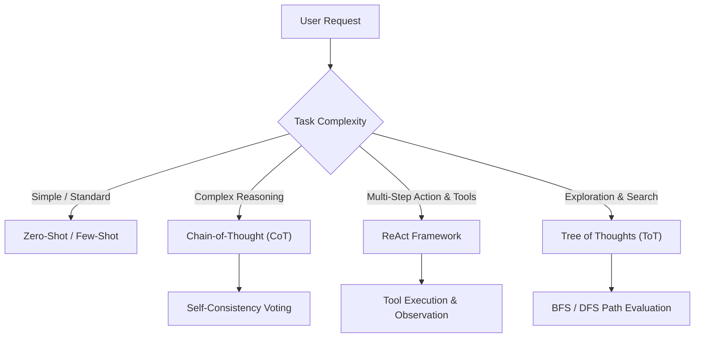

# 🧠 Prompt Engineering & LLM Architecture Hub

Welcome to the **Prompt Engineering & LLM Architecture Hub**, a structured knowledge base and reference guide dedicated to mastering prompt design, large language model (LLM) configuration parameters, reasoning frameworks, security guardrails, and production engineering practices.

---

## 📂 Repository Architecture

```text
Prompt_Engineering/
├── 📁 1-Introduction/                        # LLM foundations, transformer architecture & core components
│   └── 📄 notes.txt                         # Detailed notes on prediction engines, prompt anatomy & frontier models
├── 📁 2-Common_Terminology/                  # Core terminology, token economics, agents & security
│   └── 📄 notes.txt                         # Detailed notes on tokens, context rot, hallucinations, RAG & injection
├── 📁 3-LLM_Configuration/                   # Inference parameters & output controls
│   ├── 📁 1-Sampling_Parameter/             # Randomness & token selection mechanics
│   │   └── 📄 notes.txt                     # Temperature, Top-K, and Top-P (nucleus sampling)
│   └── 📁 2-Output_Control/                 # Generation boundaries & response formatting
│       └── 📄 notes.txt                     # Max tokens, context windows & stop sequences
├── 📁 4-Repetition_Penalties/                # Vocabulary diversity & logit penalty adjustments
│   └── 📄 notes.txt                         # Frequency penalty, presence penalty & prompt writing tips
├── 📁 5-Prompting_Techniques/                # Classical & advanced reasoning frameworks
│   └── 📄 notes.txt                         # Zero/Few-shot, CoT, ReAct, ToT, S2A, APE, Ensembling & Calibration
├── 📁 6-Best_Prompting_Practices/            # Enterprise-grade prompt engineering guidelines
│   └── 📄 notes.txt                         # Delimiters, structured schemas, guardrails & automated evaluation
└── 📄 README.md                             # Comprehensive module guide & reference manual
```

---

## 🚀 Key Modules & Curriculum Breakdown

### 1. 🔰 Fundamentals & LLM Mechanics (`/1-Introduction`)
Covers the architectural foundations of how modern Large Language Models operate under the hood:
- **Prediction Engines**: LLMs process text sequentially and predict probability distributions over the next tokens based on patterns learned from vast training datasets.
- **The Core Formula**:
  $$\text{LLM} = \text{Data} + \text{Training} + \text{Architecture}$$
- **Transformer Architecture**: Self-attention mechanisms enable the model to weigh the contextual significance of each word/token across an entire sequence.
- **Core Elements of a Prompt**:
  - `Instruction`: The explicit task or command for the model to execute.
  - `Context`: External background information guiding the model's perspective.
  - `Input Data`: The raw input, question, or payload to be processed.
  - `Output Indicator`: The target format, constraint, or structure (e.g., JSON, markdown table).
- **Frontier Model Landscape**:
  - **OpenAI**: GPT-5.4, o3, Codex, and Agents SDK.
  - **Google**: Gemini 3 multimodal ecosystem, Imagen, Veo, and Lyria.
  - **Anthropic**: Claude Opus 4.7, Sonnet 4.6, and Haiku 4.5 featuring extended thinking and 1M+ token context windows.
  - **Meta**: Open-source Llama 4 family (Maverick & Scout variants).
  - **xAI**: Grok 4.20 with real-time web access and 2M token context windows.

---

### 2. 📖 Core Terminology & Architectural Concepts (`/2-Common_Terminology`)
A deep dive into essential terminology, constraints, and concepts in modern AI engineering:
- **Tokens**: The atomic units of text processing. Averages ~0.75 words per token. Informs API cost structures, rate limits, and latency.
- **Context Window & Context Rot**: The maximum token capacity per interaction. Highlights **context rot**—the degradation of recall accuracy as token counts swell.
- **Hallucinations & Grounding**: Why models confabulate plausible falsehoods and concrete techniques to prevent them:
  - Explicit uncertainty permission: Instructing the model that saying *"I don't know"* is acceptable.
  - Chain-of-Thought self-verification.
  - Grounding strictly on user-provided source material.
- **AI Agents**: Autonomous systems pairing LLMs with **planning/reflection**, **tool access** (APIs, databases), and **memory** for complex multi-step tasks.
- **Prompt Injection Defense**: Guarding against **Direct Injection** (jailbreaks) and **Indirect Injection** (poisoned web pages or ingested PDFs) using input filtering, delimiter sandboxing, and human-in-the-loop validation.
- **Weights, Biases & Hyperparameters**: Trainable weights vs. runtime inference parameters.
- **AI vs. AGI**: Narrow task-specific models vs. hypothetical cross-domain general intelligence.
- **Retrieval-Augmented Generation (RAG)**: Grounding LLM responses in real-time external vector stores without expensive model retraining.

#### 📊 Fine-Tuning vs. Prompt Engineering

| Feature | Fine-Tuning | Prompt Engineering |
| :--- | :--- | :--- |
| **Primary Method** | Retrains and updates internal model weights | Crafts inputs to guide existing model weights |
| **Data Required** | Large, curated, task-specific labeled datasets | Instructions, formatting rules, and 1–5 examples |
| **Technical Skill** | High (Machine Learning, GPU pipelines) | Moderate (Prompt architecture, testing, domain context) |
| **Infrastructure Cost** | High (GPU clusters, fine-tuning compute) | Minimal (Standard API token consumption) |
| **Deployment Speed** | Weeks to months | Minutes to days |
| **Flexibility** | Static weights until the next retraining run | Instantaneous updates to prompts and rules |
| **Best Used For** | Proprietary tone, domain vocabularies, specialized tasks | Rapid prototyping, dynamic tasks, enterprise workflows |

---

### 3. ⚙️ LLM Configuration & Sampling Mechanics (`/3-LLM_Configuration`)

#### A. Sampling Parameters (`/1-Sampling_Parameter`)
Controls how tokens are sampled from the predicted probability distribution:
- **Temperature ($0.0 \to 1.0$)**:
  - `0.0 - 0.3`: Highly deterministic and factual. Best for coding, mathematics, extraction, and structured JSON.
  - `0.5 - 0.7`: Balanced coherence and variability. Ideal for conversational agents and summarization.
  - `0.8 - 1.0+`: High entropy and creativity. Best for brainstorming and creative storytelling.
- **Top-K**: Restricts candidate selection to the top $K$ most probable tokens (e.g., $K=30$).
- **Top-P (Nucleus Sampling)**: Selects tokens from the smallest subset whose cumulative probability reaches threshold $P$ (e.g., $P=0.95$). Dynamically adjusts candidate pool size based on distribution sharpness.

#### B. Output Controls (`/2-Output_Control`)
- **Max Tokens**: Strict ceiling on generation length. Essential for controlling latency, budget, and infinite generation loops.
- **Stop Sequences**: Specific delimiter strings (e.g., `["\n\n", "###", "</output>"]`) that immediately terminate token generation, guaranteeing clean boundaries for API parsing.

---

### 4. 🎯 Repetition Penalties & Diversity Tuning (`/4-Repetition_Penalties`)
Prevents models from getting trapped in repetitive phrasing and word loops by applying negative logit biases:
- **Frequency Penalty**: Reduces a token's probability proportionally to how many times it has already appeared in the output.
- **Presence Penalty**: Applies a flat one-time penalty to any token that has appeared at least once, forcing the model to explore new subjects and vocabulary.

| Setting | Frequency Penalty | Presence Penalty | Resulting Generation Style |
| :--- | :--- | :--- | :--- |
| **Default** (`0.0, 0.0`) | None | None | Natural, standard language flow |
| **Moderate Frequency** (`0.5, 0.0`) | Gradual logit reduction | None | Eliminates repetitive keyword loops |
| **Aggressive Presence** (`0.0, 0.8`) | None | Flat reduction once used | Maximizes topic breadth and word variety |

---

### 5. 🧩 Prompting Frameworks & Advanced Reasoning (`/5-Prompting_Techniques`)

Explore classical, advanced, and autonomous reasoning techniques documented across the curriculum:



#### 🔬 Key Techniques Catalog:
1. **Zero-Shot & Few-Shot Prompting**: Direct prompting vs. providing 1–5 exemplars to guide output formatting and classification accuracy.
2. **Step-Back Prompting**: Abstraction-first reasoning. Prompts the model to identify broad principles before solving concrete questions.
3. **Chain-of-Thought (CoT)**: Articulates intermediate reasoning steps (*"Let's think step by step"*) before computing the final answer.
4. **Self-Consistency**: Samples multiple reasoning paths and selects the consensus answer via majority vote.
5. **Tree of Thoughts (ToT)**: Systematic search over multiple intermediate thought steps using algorithms like BFS or DFS with self-evaluation and backtracking.
6. **ReAct (Reasoning + Acting)**: Interleaves `Thought -> Action -> Observation` loops, allowing LLMs to interact with search engines, calculators, and custom tools.
7. **System & Role Prompting**: Setting explicit personas, domain vocabularies, and boundary conditions.
8. **Contextual Prompting**: Grounding responses strictly in provided documents or reference chunks.
9. **Automatic Prompt Engineering (APE)**: Utilizing LLMs to generate, test, and mathematically optimize candidate prompts.
10. **System 2 Attention (S2A)**: Asks the model to rewrite and filter extraneous or biased context before producing an answer.
11. **Re-reading (RE2) & Rephrase and Respond (RaR)**: Re-processing inputs to guarantee comprehensive comprehension.
12. **LLM Self-Evaluation & Constitutional AI**: Automated critique-and-revision pipelines enforcing safety and factual accuracy.
13. **Model Calibration**: Aligning model confidence scores with factual accuracy using temperature scaling and logit analysis.

---

### 6. 🏆 Production Prompting Best Practices (`/6-Best_Prompting_Practices`)

1. **Delimiters & Section Isolation**: Use triple backticks (` ``` `), markdown headers, or XML tags (`<instructions>`, `<context>`, `<input>`) to clearly separate prompt instructions from user-supplied data.
2. **Clear Directives over Negative Constraints**: Focus on telling the model what to do rather than listing long strings of *"Don't do X"*.
3. **Structured Output Schemas**: Explicitly demand JSON, XML, or Markdown tables with provided schema definitions or TypeScript interfaces.
4. **Parameter Sandboxing**: Set conservative `temperature` ($0.0 - 0.2$) and strict `stop_sequences` for downstream API integrations.
5. **Prompt Injection Hardening**: Treat all user inputs as untrusted data; sanitize and enclose them within isolated XML blocks.
6. **Automated Evaluation**: Track prompt iterations against golden test suites with automated scoring and regression testing.

---

## 💡 Prompt Engineering Frameworks Quick Reference

<details>
<summary><b>1. Zero-Shot vs. Few-Shot Example</b></summary>

**Zero-Shot:**
```text
Classify the sentiment of the following review as Positive, Neutral, or Negative:
Review: "The delivery arrived on time, but the packaging was slightly dented."
Sentiment:
```

**Few-Shot:**
```text
Classify the sentiment of the following reviews:

Review: "The screen quality is absolutely stunning!"
Sentiment: Positive

Review: "The battery lasts only 2 hours."
Sentiment: Negative

Review: "The delivery arrived on time, but the packaging was slightly dented."
Sentiment: Neutral
```
</details>

<details>
<summary><b>2. ReAct (Reasoning + Acting) Cycle Pattern</b></summary>

```text
Question: What is the age difference between the current CEO of Apple and Microsoft?

Thought 1: I need to find the current CEO of Apple and their birth date.
Action 1: Search["Current CEO of Apple birth date"]
Observation 1: Tim Cook was born on November 1, 1960.

Thought 2: Now I need to find the current CEO of Microsoft and their birth date.
Action 2: Search["Current CEO of Microsoft birth date"]
Observation 2: Satya Nadella was born on August 19, 1967.

Thought 3: I need to calculate the age difference between 1960 and 1967.
Action 3: Calculate[1967 - 1960]
Observation 3: 7

Thought 4: I have the required information to form the final answer.
Final Answer: Tim Cook is approximately 7 years older than Satya Nadella.
```
</details>

<details>
<summary><b>3. XML Tag Delimited Production Prompt Template</b></summary>

```text
You are a Senior Technical Documentation Engineer.

<instructions>
Summarize the technical changes described in the release notes below.
Output the summary strictly as a JSON object matching the provided schema.
Do not include any conversational preamble or conversational closing.
</instructions>

<schema>
{
  "version": "string",
  "breaking_changes": ["string"],
  "enhancements": ["string"],
  "bug_fixes": ["string"]
}
</schema>

<release_notes>
{{USER_RELEASE_NOTES_PAYLOAD}}
</release_notes>
```
</details>

---

*Part of the AI & Full-Stack Development Learning Journey.*
